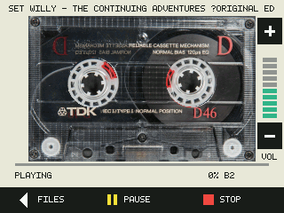
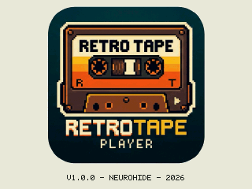
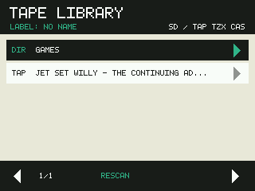
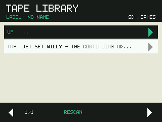
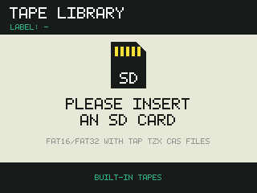
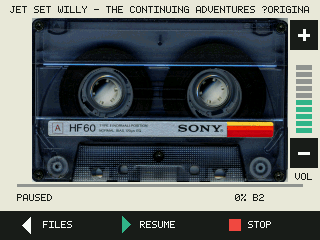

# RetroTape Player

A touchscreen cassette player for retro computers, running on the
**ESP32-2432S028R** ("Cheap Yellow Display": classic ESP32, 2.8" ILI9341 LCD,
XPT2046 touch). It reads ZX Spectrum `.tap` / `.tzx` and MSX `.cas` tape images
from a microSD card and plays them back as the audio signal a real cassette
recorder would produce, so the computer can load them through its tape input.



## Purpose

Old home computers load software from audio cassettes. Tape images preserve
those programs as files, but loading one on the original machine still needs a
tape signal. RetroTape Player turns the cheap ESP32 display board into a
stand-alone tape deck: browse the card on the touchscreen, tap a tape, and the
board plays it with the original timings, with pause, stop and volume controls
like a real recorder.

## Screenshots

| | |
| --- | --- |
|  |  |
| Start-up splash with version, author and build year | Tape library: folders first, then tapes, with the card's label |
|  |  |
| Inside a folder; `UP ..` goes back | Shown until a FAT16/FAT32 card is inserted |
|  |  |
| Playing: the reels turn, with progress and block number | Paused, with the alternate cassette and the volume bar |

The screenshots come from the Wokwi simulator (see [Simulation](#simulation)).

## Features

- ZX Spectrum **TAP** and **TZX** (turbo, pure data, direct recording, CSW,
  generalized data, loops, jumps and "stop the tape" blocks) and MSX **CAS**.
- Library browser with folders, five entries per page, long file names, and the
  card's volume label in the header.
- Cassette screen with animated reels, progress bar, **PAUSE / RESUME**,
  **STOP / REPLAY** and a 0–10 **volume** control.
- Volume and touch calibration are saved on the card (`settings.json`,
  `calibration.json`).
- The card can be inserted and removed at any time; non-FAT cards are reported,
  never formatted.
- Built-in tapes in flash, playable without a card.

## Requirements

### Hardware

- An **ESP32-2432S028R** board with 4 MB of flash and the ILI9341 display
  (variants with an ST7789 display need a different LCD setup).
- A **microSD card** formatted as **FAT16 or FAT32** (not exFAT).
- A small **speaker** on the board's speaker connector, to listen.
- To load a real computer: an **attenuated, AC-coupled audio lead** from the
  board to the computer's EAR / tape input (see
  [Connecting a computer](#connecting-a-computer)).
- A USB cable for flashing.

### Software

- [**ESP-IDF 5.4**](https://docs.espressif.com/projects/esp-idf/en/v5.4/esp32/get-started/index.html)
  (its installer also provides Python, CMake, Ninja and the Xtensa toolchain).
- A USB-serial driver for the board's CH340 chip, if your system lacks one.
- Optional: VS Code with the **ESP-IDF** extension, and the **Wokwi** extension
  to run the simulator.
- Optional: a C11 compiler to run the decoder tests on your computer.

## Build and Load

1. Install ESP-IDF 5.4 by following Espressif's getting-started guide, then open
   a terminal with its environment loaded:

   ```sh
   . $HOME/esp/v5.4/esp-idf/export.sh      # Linux / macOS; on Windows use the ESP-IDF shell
   ```

2. Build from the project folder. The target (`esp32`), 4 MB flash and the
   partition table come from `sdkconfig.defaults`:

   ```sh
   cd "tape player"
   idf.py build
   ```

3. Connect the board over USB and flash it, replacing the port with yours
   (macOS `/dev/cu.usbserial-*`, Linux `/dev/ttyUSB0`, Windows `COM3`):

   ```sh
   idf.py -p /dev/cu.usbserial-110 flash monitor
   ```

   This writes the firmware and the built-in tape library (the `sdcard/` folder,
   packed into the 2 MB `storage` partition). `monitor` shows the boot log;
   leave it with `Ctrl+]`. If the board does not enter download mode by itself,
   hold **BOOT** while flashing starts.

In VS Code, the ESP-IDF extension's **Build your project** and **Flash your
project** commands do the same. To change a configuration option, edit
`sdkconfig.defaults` and delete the generated `sdkconfig` before building.

## Usage

### Prepare the card

Format a microSD card as **FAT16 or FAT32** and copy ZX Spectrum `.tap` /
`.tzx` or MSX `.cas` files onto it, in the root or in folders. The firmware
adds `settings.json` (and `calibration.json` on XPT2046 boards) to the root.

### First start

At power-on without a card the board asks you to
**INSERT AN SD CARD**; a card it cannot use shows **CHECK THE SD CARD AND
REINSERT**. On the first start with a card, an XPT2046 board shows the touch
calibration screen: tap the centre of each of the three crosses (see
[Touch Calibration](#touch-calibration)).

### Browse and play

1. The library lists folders, then tapes with their type (`TAP`, `TZX`,
	`CAS`), sorted by name. Touch a folder to open it and `UP ..` to go back; the
	arrows change pages and **RESCAN** reads the card again.
2. Touch a tape to start it. The cassette screen shows the file name, turning
	reels, a progress bar, the status and the current block.
3. **PAUSE** holds the tape (the output goes silent) and **RESUME** continues.
	Pause in the silent gap between blocks, as with a real recorder: pausing in
	the middle of a block usually causes a loading error.
4. The square stops the tape, the triangle (**REPLAY**) starts it again from the
	beginning, and **FILES** stops and returns to the library.
5. **+** and **-** right of the cassette set the volume from 0 (silent) to 10,
	also while playing. If the computer fails to load, try another volume.

On the computer, start loading as usual, for example `LOAD ""` on a Spectrum or
`RUN "CAS:"`, `BLOAD "CAS:",R` or `CLOAD` on an MSX, then start the tape. When a
TZX file asks you to stop the tape, the player pauses with `TAPE STOP - PRESS
RESUME`.

### Connecting a computer

The onboard speaker output is for listening. Loading a real Spectrum or MSX
requires an appropriately attenuated, AC-coupled audio interface to its EAR or
tape input, and the signal level and timing still have to be checked on your
hardware. Do not connect the amplified speaker output directly to the computer,
or a speaker directly to the ESP32 DAC pin.

## Reference

### Library and Card

The library skips hidden entries and sorts
case-insensitively. Long filenames are enabled in FATFS. It holds up to 96
entries (folders and files) per folder, five per page; `96 MAX` indicates
additional entries were not listed. While a folder is read (opening one,
**RESCAN**, a newly inserted card, the built-in tapes) a **PLEASE WAIT** pane
covers the screen and touches are ignored until it closes and the finger is
lifted. **RESCAN** stays in the open folder, returning to the root if it no
longer exists; inserting or removing a card also returns to the root. Long names
scroll on the cassette label during playback. The pixel font renders ASCII
names in uppercase; other characters appear as `?`. Empty directories,
malformed TAP blocks, bad checksums, and read/audio failures have explicit
display states. A failed mount **never formats the card**.

Each tape started from the library deconding the file (**REPLAY** keeps the current one).

The slot has no card-detect switch, so while nothing is playing the firmware
checks the card about once a second. An inserted card is mounted and its library
shown; a card that answers but holds no FAT16 or FAT32 volume (exFAT, FAT12,
unformatted) shows **CHECK THE SD CARD AND REINSERT** with an alert icon until it
is removed. Pulling the card out returns to the insert screen. Stop playback
before removing a card.

**BUILT-IN TAPES** on either screen opens a read-only FAT partition in flash
(`storage` in `partitions.csv`), built from the `sdcard/` folder and written
with the firmware; inserting a card switches to it. The header shows `SD / TAP TZX CAS`
or `FLASH / TAP TZX CAS` for the active source (or the open folder's path), and
under the title `LABEL:` with the card's FAT volume label (`NO NAME` if it has
none, `BUILT-IN` for the flash library, `-` without a usable card).

### Settings

When a card is mounted and verified (at startup or when inserted later), the
firmware reads the volume from `settings.json` in the card's root. If the file
is missing or invalid, the volume is set to the middle value, 5, and the file is
written:

```json
{
	"volume": 5
}
```

A changed volume is written back when you leave the tape screen with **FILES**.
Without a card the volume starts at 5 and is not saved. Volume 10 uses the DAC's
full swing and 5 half of it.

### Board Connections

| Peripheral | GPIO |
| --- | --- |
| ILI9341 MOSI / MISO / clock | 13 / 12 / 14 |
| ILI9341 CS / DC / backlight | 15 / 2 / 21 |
| XPT2046 MOSI / MISO / clock | 32 / 39 / 25 |
| XPT2046 CS / interrupt | 33 / 36 |
| microSD MOSI / MISO / clock / CS | 23 / 19 / 18 / 5 |
| Built-in DAC to onboard speaker amplifier | 26 |
| Optional FT6206 touch SDA / SCL (CN1 connector) | 27 / 22 |

Touch uses a separate software SPI bus, leaving both hardware SPI buses available
for LCD and SD. At startup the firmware also probes the CN1 I2C pins for an
FT6206 capacitive touch controller (address 0x38) and, when one answers, uses it
instead of the XPT2046; the simulator relies on this. Boards with a different LCD
controller (such as ST7789 variants) need a different LCD setup.

### Touch Calibration

Calibration is tied to the card. Each time a card has been mounted and verified
as FAT16/FAT32, at startup or when inserted later, the firmware applies
`calibration.json` from its root. If the file is missing or invalid, it shows the
calibration screen before the library: tap the centre of each of three crosses. The three points give an affine mapping from raw XPT2046 readings
to screen pixels, which covers swapped, mirrored, offset, and slightly rotated
panels. The result is written back to the card:

```json
{
	"version": 1, "width": 320, "height": 240,
	"x": [0, 0.0862, -17.24],
	"y": [-0.0646, 0, 251.9],
	"points": [{"screen_x": 32, "screen_y": 32, "raw_x": 3405, "raw_y": 571}, ...]
}
```

`screen_x = x[0] * raw_x + x[1] * raw_y + x[2]`, and likewise for `y`;
`points` records the raw readings for reference. Delete the file to recalibrate.
Without a card there is no calibration; the insert screen uses a default
mapping, and its only control is the full-width **BUILT-IN TAPES** bar. With an FT6206
there is no calibration screen: it reports panel pixels, which map to the
screen as `x = 319 - raw_y`, `y = 239 - raw_x` unless `calibration.json` says
otherwise.

### Tape Formats and Audio

`main/tap.c` reads standard Spectrum length-prefixed TAP blocks and checks each
block's XOR checksum before emitting it. It generates the 3.5 MHz Spectrum ROM
timings: 8063 header / 3223 data pilot pulses at 2168 T-states, 667/735 sync
pulses, then two 855/1710 T-state pulses per zero/one bit, MSB first. Each block
ends with a one-second silent pause. Turbo loaders and other computers'
TAP formats are not supported in `.tap` files; use TZX for those.

`main/tzx.c` plays Spectrum `.tzx` images (format 1.x), streamed so data blocks
of any size work:

| Blocks | Handling |
| --- | --- |
| 0x10 standard, 0x11 turbo, 0x14 pure data | pilot, sync and data pulses as stored; the last byte may use fewer bits |
| 0x12 pure tone, 0x13 pulse sequence | played as stored |
| 0x15 direct recording, 0x18 CSW (RLE) | sampled levels turned into edges |
| 0x19 generalized data | pilot/sync and data symbol tables, including symbols that continue or force the level |
| 0x20 pause | silence; **pause 0 ("stop the tape") pauses the player** with `TAPE STOP - PRESS RESUME`, so press **RESUME** when the program asks you to start the tape |
| 0x23 jump, 0x24/0x25 loop, 0x26/0x27 call sequence | followed |
| 0x2B set signal level | applied |
| 0x21/0x22 group, 0x28 select, 0x2A stop if 48K, 0x30-0x35 and 0x5A info | skipped |

Data checksums are not checked, since protected tapes break them on purpose.
CSW blocks with Z-RLE (zlib) compression stop with `UNSUPPORTED TAPE BLOCK`;
a file without the `ZXTape!` signature or with a truncated block shows
`INVALID TZX FILE`. The output can only toggle, so absolute signal levels
are approximated by their edges, which is what the Spectrum's EAR input reacts
to.

`main/cas.c` plays MSX `.cas` images as the standard 1200 baud MSX tape signal:
a 0 bit is one 1200 Hz cycle, a 1 bit two 2400 Hz cycles, and each byte is a
start bit, eight data bits (least significant first) and two stop bits. Every
block marker (`1F A6 DE BA CC 13 7D 74`) becomes silence plus a 2400 Hz sync
tone: 2 s and 16000 cycles before the first block and before any block that
starts with a file-type header (ten `D0`, `D3` or `EA` bytes), otherwise 1 s and
4000 cycles, as openMSX does. Bytes before the first marker are skipped; a file
without a marker is reported as `INVALID CAS FILE`. The image is streamed, so
CAS files of any size play. Load with `CLOAD`, `BLOAD "CAS:",R` or
`RUN "CAS:"` as the program requires.

Audio runs on a separate FreeRTOS task through the ESP-IDF continuous DAC driver
(I2S0 DMA), at 250 ksample/s on GPIO26. Fractional sample durations accumulate
across pulses rather than rounding each pulse independently. Only the current
TAP block is held in RAM (at most 65535 bytes); an indexed framebuffer keeps
display memory bounded. Stop requests are checked while filling audio buffers.

### Simulation

Wokwi's `board-esp32-2432s028r` part is not usable here: its XPT2046 never
drives MISO or PENIRQ, and its microSD slot is not wired. `diagram.json` instead
rebuilds the board from simulated parts on the same GPIOs: an ESP32 DevKitC V4,
an ILI9341 with FT6206 capacitive touch (on the CN1 pins, see above), and a
microSD card. Put tape files in the `sdcard/` folder, build the firmware, then
run **Wokwi: Start Simulator** and click the screen to touch it.

The simulated card is filled from `sdcard/` at every start; restart the
simulation after changing the folder. Nothing is written back, because Wokwi's
write-back mirrors the card as it was at start and would delete files added to
`sdcard/` while the simulation ran. The simulator starts straight in the library,
since the FT6206 needs no touch calibration.

The simulator has no speaker, and it reports task watchdog warnings for
`tap_audio` during playback. The XPT2046 touch path, actual DAC playback, and
real Spectrum loading must be checked on physical hardware.

### Cassette Photos

The playback screen alternates between two photos:

- `assets/tdk-d46.jpg`: "TDK D46 audio cassette" by Hannes Grobe/AWI,
  [CC BY 3.0](https://creativecommons.org/licenses/by/3.0/), from
  [Wikimedia Commons](https://commons.wikimedia.org/wiki/File:TDK_D46_audio_cassette.jpg).
- `assets/sony-hf60.jpg`: "a close up of an audio tape recorder" by
  [Bruno Guerrero](https://unsplash.com/@pray4bokeh), from
  [Unsplash](https://unsplash.com/photos/ejrv1jFK6G8), under the
  [Unsplash License](https://unsplash.com/license).

`tools/cassette_image.py` crops a photo to the shell, scales it to 256 × 164,
reduces it to 248 colours, and pre-renders 24 rotations of each hub into
`main/cassette-<photo>.bin`, which is embedded in the firmware. Each photo has
its own colours; the firmware swaps them into the display palette when the
cassette changes. To regenerate (macOS `sips` converts the JPEG; the script
needs only Python):

```sh
sips -s format bmp assets/tdk-d46.jpg --out /tmp/tdk-d46.bmp
python3 tools/cassette_image.py tdk-d46 /tmp/tdk-d46.bmp main/cassette-tdk-d46.bin
sips -Z 1920 -s format bmp assets/sony-hf60.jpg --out /tmp/sony-hf60.bmp
python3 tools/cassette_image.py sony-hf60 /tmp/sony-hf60.bmp main/cassette-sony-hf60.bin
```

The same script makes the splash, `main/splash.bin`, from `assets/splash.jpeg`:
it crops the rounded icon, scales it to 200 × 200 and makes its white surround
transparent. `assets/splash.jpeg` was generated with Google's Nano Banana (Gemini
image generation) AI model.

```sh
sips -s format bmp assets/splash.jpeg --out /tmp/splash.bmp
python3 tools/cassette_image.py splash /tmp/splash.bmp main/splash.bin
```

The crop and hub positions in the script's `PHOTOS` table are measured on these
photos at those sizes; another photo needs its own entry, a new `.bin` in
`EMBED_FILES`, and an entry in `cassette_images[]` in `main.c`.

### Decoder Tests

Run the portable decoder tests on a host with a C11 compiler:

```sh
cc -std=c11 -Wall -Wextra -Werror -I main main/tap.c tests/tap_test.c -o /tmp/tap_test
/tmp/tap_test
cc -std=c11 -Wall -Wextra -Werror -I main main/tap.c main/tzx.c tests/tzx_test.c -o /tmp/tzx_test
/tmp/tzx_test
cc -std=c11 -Wall -Wextra -Werror -I main main/tap.c main/cas.c tests/cas_test.c -o /tmp/cas_test
/tmp/cas_test
```

Tests cover header/data pilot counts, sync and data pulse lengths, MSB-first
bit ordering, multiple blocks, progress, checksum failures, malformed and empty
files, truncated blocks, and cancellation. TZX tests check that standard blocks
sound exactly like the same TAP file, then cover every sound block type, loops,
jumps, call sequences, stop blocks, level continuation in generalized data,
unsupported CSW compression, invalid files and cancellation. CAS tests cover silence and sync
tone lengths, long versus short headers, bit and byte framing, skipped leading
bytes, files without markers, and cancellation.

## Licence

Created by neurohide.

This program is free software: you can redistribute it and/or modify it under
the terms of the GNU General Public License as published by the Free Software
Foundation, either version 3 of the License, or (at your option) any later
version (`GPL-3.0-or-later`). It is distributed in the hope that it will be
useful, but WITHOUT ANY WARRANTY; see [LICENSE](LICENSE) for the full text.

The firmware is built with third-party code under its own, GPL-compatible
licences, declared for FOSSA in `fossa-deps.yml`:

| Component | Version | Licence |
| --- | --- | --- |
| ESP-IDF | 5.4 | Apache-2.0 |
| cJSON (bundled with ESP-IDF) | 1.7.18 | MIT |
| FatFs (bundled with ESP-IDF) | R0.15 | BSD-1-Clause |
| FreeRTOS kernel (bundled with ESP-IDF) | 10.5.1 | MIT |

The cassette photos keep their own licences (see [Cassette Photos](#cassette-photos)).
The splash image was generated with Google's Nano Banana AI model; Google's terms
do not claim ownership of generated images.

To check dependencies with the [FOSSA CLI](https://github.com/fossas/fossa-cli)
(`.fossa.yml` holds the project settings):

```sh
fossa analyze --output          # local only, prints the dependency list
FOSSA_API_KEY=... fossa analyze # uploads to fossa.com for reports
FOSSA_API_KEY=... fossa report attribution --format html > attribution.html
```
